<div align="center">

# ArogyaDoot
### Offline-first AI field assistant for ASHA healthcare workers

**Ask a guideline. Inspect the cited source. Document the visit. Track the next action.**

[](https://github.com/ektasikka1989-cmyk/Arogyadoot/releases)


</div>

ArogyaDoot is an Android assistant built for **Accredited Social Health Activists (ASHAs)**. It brings source-grounded healthcare guidance, household records, upcoming visits, follow-ups, registers, and printable records into one field-friendly application. Its core guidance and on-device AI can run without an internet connection **after the appropriate model and reference library are installed**.

> **Scope:** A decision-support and fieldwork prototype, not a diagnostic device or a substitute for an ANM, physician, or approved clinical procedures. Always verify the cited guideline and escalate urgent clinical concerns through established channels.

## See ArogyaDoot in action

<table>
<tr><td align="center">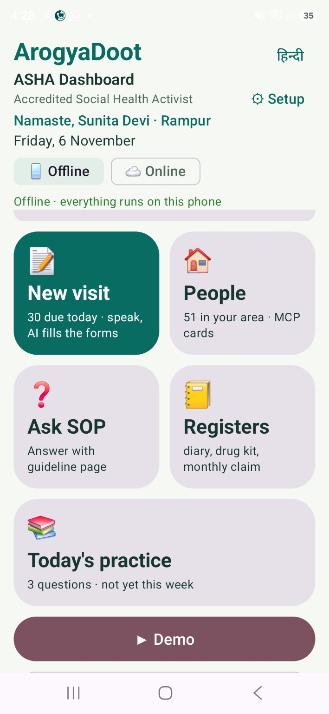<br/><strong>Offline-first dashboard</strong></td><td align="center">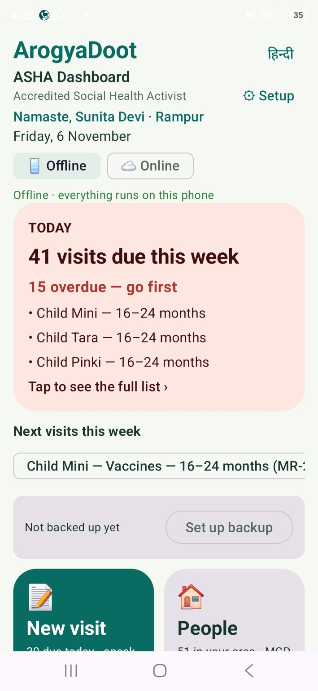<br/><strong>Prioritise today's fieldwork</strong></td></tr>
<tr><td align="center">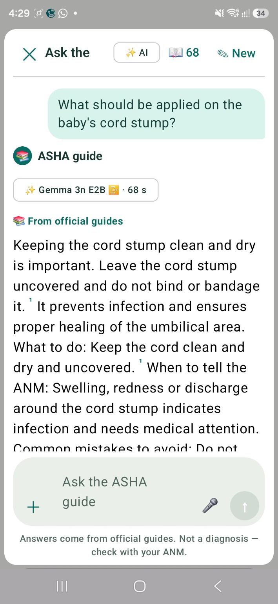<br/><strong>Ask SOP — on-device answer</strong></td><td align="center">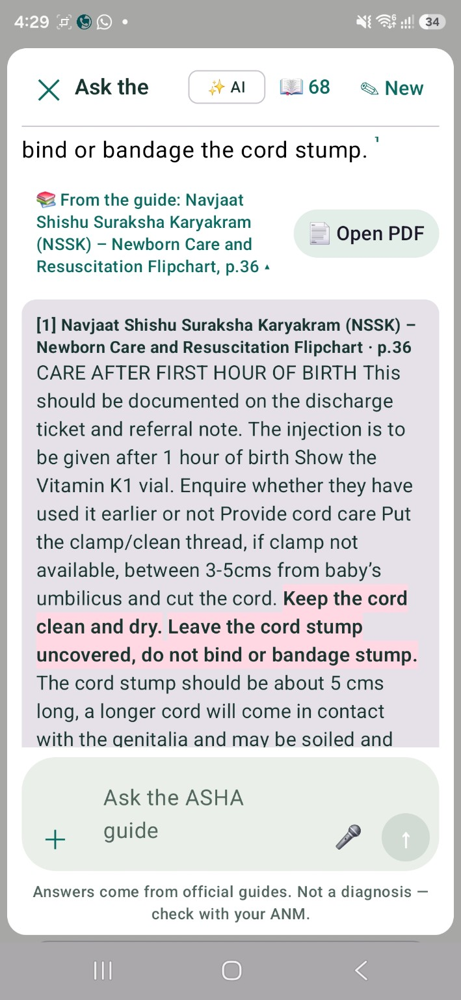<br/><strong>Inspect the exact cited passage</strong></td></tr>
<tr><td align="center">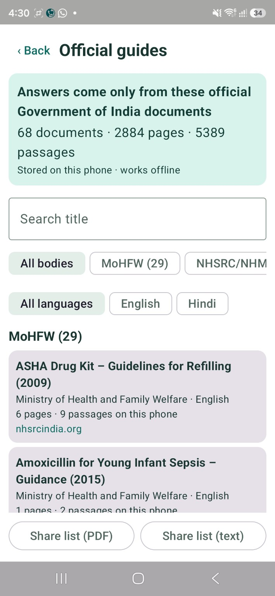<br/><strong>Browse official guides</strong></td><td align="center">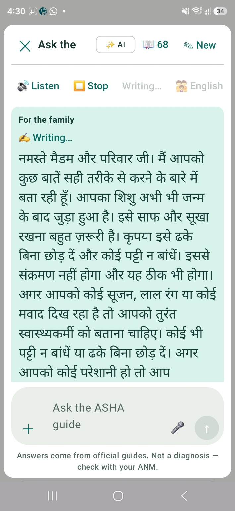<br/><strong>Family-friendly Hindi guidance</strong></td></tr>
<tr><td align="center">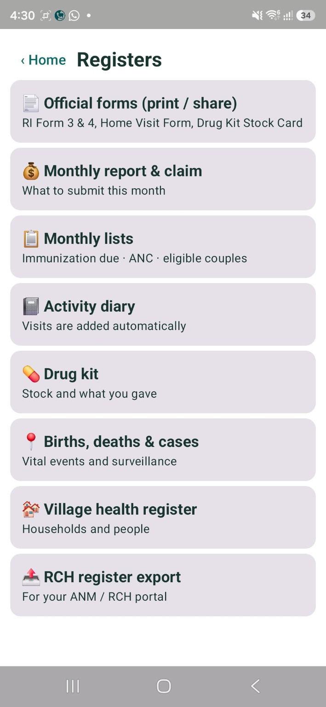<br/><strong>Registers and reporting</strong></td><td align="center">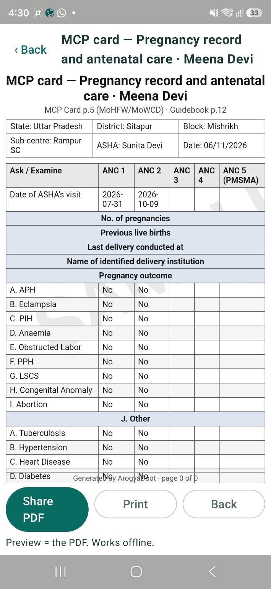<br/><strong>MCP card / PDF output</strong></td></tr>
</table>

*Screenshots are from the version 1.0.0 Android interface. Any pictured names, household details and health records must be demo data or cleared for publication before making the repository public. Screenshots demonstrate interfaces, not clinical-validation outcomes.*

## Why it exists

ASHA workers manage household outreach, maternal and child health follow-ups, records, reporting, and communication with families. Important procedures are spread across many government guides. Finding a specific passage mid-visit, confirming its meaning, documenting what happened, and remembering the next action are separate tasks. ArogyaDoot connects these steps within one offline-capable workflow.

## What you can do

| Area | Available capability / purpose |
|---|---|
| **Ask SOP** | Ask a natural-language question against installed healthcare guidance and view a grounded answer with source references. |
| **Evidence and citations** | View named guide, page number, supporting excerpt, highlighted passage, and open the PDF for verification. |
| **Offline AI** | Use local Gemma 3n E2B inference via LiteRT-LM when model and guide assets are installed. |
| **Optional online AI** | Configure a Groq API key and use the available Qwen provider; availability, model access and internet are required. |
| **Multilingual support** | Hindi and English interfaces and family-facing assistance; output quality varies with input and speech environment. |
| **Households and people** | Organise records and field activities, including maternal/child health use cases. |
| **Visits and reminders** | Manage new visits, due/overdue follow-ups and activity records. |
| **Registers** | Access official forms, monthly lists, monthly reports and claims, activity diary, drug-kit tracking, vital events, village registers and RCH export workflows. |
| **MCP / antenatal documentation** | Preview and share/print generated record PDFs from the supported form workflow. |
| **Voice and OCR** | Speech and document-capture assistance in supported screens; verify recognition and any extracted table values manually. |

### Ask SOP: the feature at the centre of the product

For example, an ASHA can ask: **“What should be applied on the baby's cord stump?”** The shown offline workflow displays guidance from an installed newborn-care source. Instead of offering an unsupported answer, the interface provides a guide title, cited page, a highlighted source passage and **Open PDF** action. This helps a worker check the originating guidance before communicating or recording an action. The example should not be treated as individual medical advice.

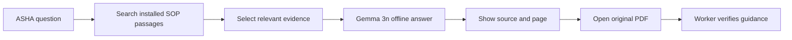

### Example household-visit journey

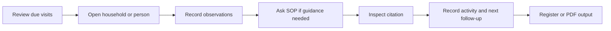

These diagrams describe the intended workflow; availability of each action depends on the selected screen and installed resources.

## AI and data architecture

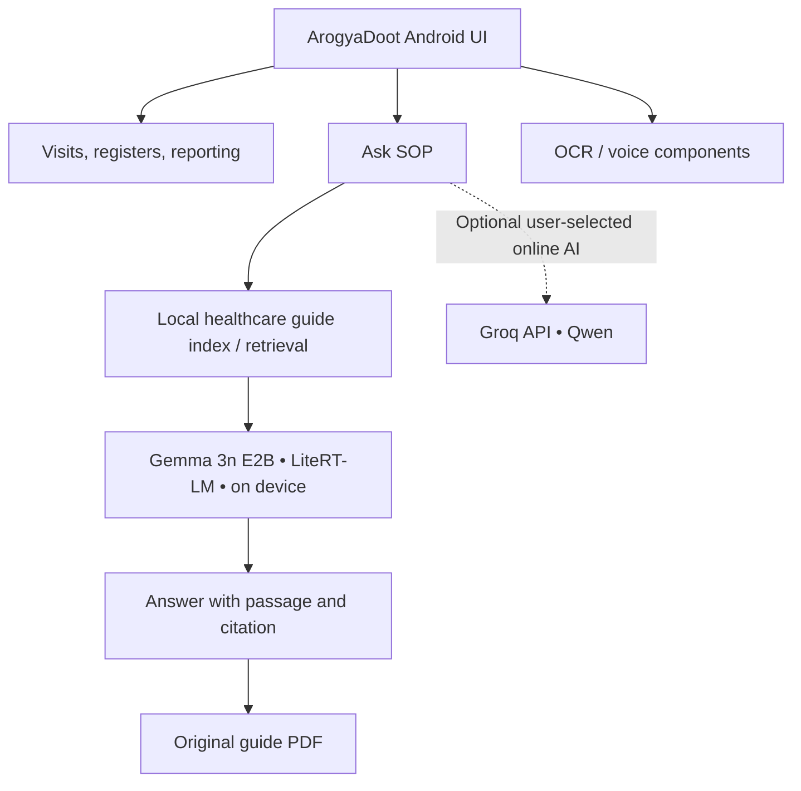

**Local model:** `gemma-3n-E2B-it-int4.litertlm`  
**Configured model source:** [Gemma model download](https://huggingface.co/datasets/EktaSikka/Gemma/resolve/main/gemma-3n-E2B-it-int4.litertlm?download=true)  
**Cloud provider:** Groq, using the configured Qwen model if accessible for the account.  
**Architecture boundary:** RAG retrieval, source provenance and UI citation display are application functionality; a generative model by itself does not establish that a clinical answer is correct.

### Official guide library

The screenshots from the current installation show **68 documents, 2,884 pages and 5,389 passages**, stored locally. Counts are **installation-specific**, and may change when guides are added or reindexed. The guide browser supports document discovery and filters such as language and publishing body. Sources can be inspected directly rather than trusting a generated answer alone.

### Offline and online behavior

| Without internet | With internet (optional) |
|---|---|
| Locally installed model and guide search | Optional Groq/Qwen access with a configured API key |
| Source-grounded answers and PDF viewing when resources are available | Online generation where the API and account support it |
| Visits, records and local documents | External services may process data sent to them; avoid sending identifiable patient details without appropriate safeguards |

**Model download is an initial online setup step**; offline operation applies after installation. Not every OCR, speech or cloud feature has the same offline capability. Check the relevant setup screen and feature status.

## Registers and digital documentation

The Registers screen groups **official forms**, **monthly reports and claims**, **monthly lists** (including ANC and immunisation due), **activity diary**, **drug kit**, **births/deaths/cases**, **village health register**, and **RCH export**. The MCP card screen demonstrates antenatal record preview with **Share PDF**, **Print**, and **Back** actions. Use these as workflow aids, and verify generated records against original records before distribution.

## Install ArogyaDoot v1.0.0

1. Visit the [Releases page](https://github.com/ektasikka1989-cmyk/Arogyadoot/releases).
2. Download the **APK attached to the v1.0.0 release**, if one has been published. The source repository alone does not install an Android app.
3. Install on a compatible Android ARM64 device using Android's installation prompt. Install only packages from a release you trust.
4. Open the app, complete initial setup, and download the local Gemma model and available healthcare guide library as prompted.
5. Allow the device sufficient free storage and memory for the model, guide data and other required resources.
6. Use **Offline** mode for local guidance; configure an optional Groq key only when online features are needed.

### Build from source

Requirements: Android Studio, compatible Android SDK/NDK and JDK as declared by the Gradle project. The repository may rely on locally supplied, ignored native assets and model files; a fresh clone is not necessarily a complete reproducible release build until those dependencies are supplied.

```powershell
git clone https://github.com/ektasikka1989-cmyk/Arogyadoot.git
cd Arogyadoot
.\gradlew.bat :app:assembleDebug
```

Typical debug APK location: `app/build/outputs/apk/debug/app-debug.apk`. Debug builds are not equivalent to a verified signed production release. Do not add API keys or model weights to Git.

### Project configuration

- **Android application ID:** `com.arogyadoot.app`
- **Release version:** `1.0.0`
- **Gemma:** installed separately; model data is not required in Git history.
- **Groq:** user-supplied API key; do not commit or display it in screenshots or logs.
- **Knowledge base:** install and verify official guide data using supported setup paths.

## Privacy, safeguards and limitations

- Use only demonstration data in publicly shared screenshots and issue reports.
- Keep device backups secure, and verify local storage, export, and device access controls before handling real patient information.
- Cloud requests require informed local policy and appropriate data minimisation; do not assume all cloud traffic remains on device.
- A source citation improves auditability but is **not a guarantee** that the model's interpretation is correct, complete or up to date.
- Verify clinical guidance, urgently refer warning signs through approved channels, and retain qualified human oversight.
- OCR and table extraction may misread handwritten or columnar records; inspect all extracted fields before saving or sharing.
- Speech accuracy, model memory usage, processing time and multilingual performance vary by device.
- Large-scale ASHA field deployment, model accuracy, and clinical outcomes have not been independently validated by this README.

## Troubleshooting

| Symptom | What to check |
|---|---|
| Offline AI unavailable | Model download complete, compatible runtime, storage and memory availability; restart and retry without deleting data. |
| SOP answer lacks a source | Verify guide installation and retrieval; do not treat an uncited response as verified guidance. |
| Groq errors | Internet connectivity, API key validity, rate limits and model availability. |
| OCR or voice inaccurate | Lighting, image quality, table layout, language settings and microphone permissions. |
| Unexpected crash | Record device/API level, reproduction steps and a redacted crash log when reporting an issue. |

## Repository and support

- [Source repository](https://github.com/ektasikka1989-cmyk/Arogyadoot)
- [Issues / bug reports](https://github.com/ektasikka1989-cmyk/Arogyadoot/issues)
- [Version 1.0.0 releases](https://github.com/ektasikka1989-cmyk/Arogyadoot/releases)

When opening an issue, include your app version, Android version, steps to reproduce and redacted logs. Never paste API keys, names, addresses or patient records.

## Roadmap

More reliable OCR column mapping, streamlined inline dictation, broader on-device compatibility, guided field validation and reproducible benchmarking. These are improvement priorities, **not claims that every item is already delivered in v1.0.0**.

---

<div align="center"><strong>ArogyaDoot 1.0.0</strong><br/>Guidance you can verify. Fieldwork you can follow through.</div>
