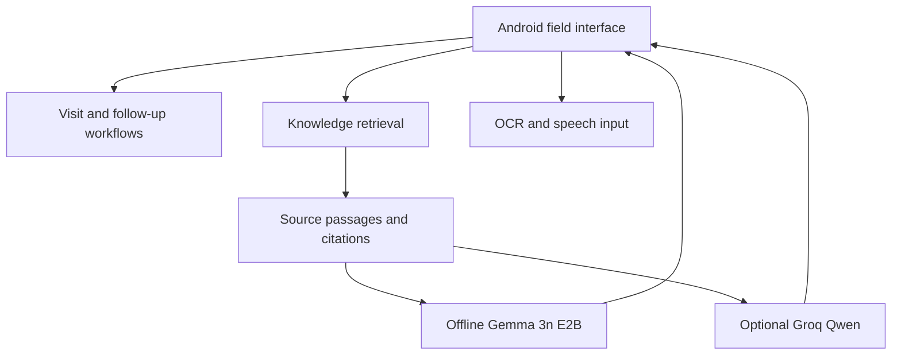

# ArogyaDoot

**An offline-first Android field assistant for community health workers.**

ArogyaDoot helps Accredited Social Health Activists (ASHAs) find relevant guidance in health programme documents, organize household visits, capture field observations, and plan follow-up work. It combines an on-device knowledge base with AI-assisted search and drafting, while keeping the health worker in control of every record and action.

> **Development status:** Active prototype. This repository documents an evolving Android application. Features and model integrations must be verified on the target device before field use. ArogyaDoot is an assistive workflow tool, not a medical device or a substitute for clinical judgment.

## Verification status

The current AI engine (offline Gemma 3n + optional Groq Qwen cloud) is **code-complete and build-verified**: `gradlew :app:assembleDebug` succeeds and the APK installs as `com.arogyadoot.app` / `ArogyaDoot`. The following are **not yet proven on a device** and must not be described as working until they are:

- Downloading the Gemma bundle from the owner URL, loading the `.litertlm` file, and running text inference through the LiteRT runtime on a phone (including load time and RAM behavior on a 6 GB device).
- Offline image understanding through Gemma vision.
- The Groq model id `qwen/qwen3.8-27b` existing on a given account (confirm via the authenticated Groq Models API), and end-to-end cloud text generation, streaming, Hindi/Hinglish handling, and error behavior.
- Cloud photo reading (whether the Groq model consumes the `image_url` parts the app sends). If it does not, cloud vision will be marked unavailable rather than worked around.
- Live microphone dictation runs (speech appears inline in the field; host-tested cursor logic only so far).

Speech recognition is on-device Whisper only; cloud transcription is retired. Drug-kit counting is the on-phone counter or tap-to-count; cloud counting is retired. Details: `GEMMA_MIGRATION_REPORT.md`, `GROQ_QWEN_INTEGRATION_REPORT.md`, `REGRESSION_REPORT.md`, `VISION_VERIFICATION.md`, `VOICE_INPUT_REGRESSION.md`, `EMULATOR_MEMORY_RCA.md`.

## What ArogyaDoot does

### SOP guidance with evidence

- Search an installed knowledge base of health guidelines and standard operating procedures (SOPs).
- Ask questions in plain language, including Hindi or mixed Hindi-English where supported by the active models and retrieval index.
- Inspect source references and retrieved passages alongside AI-assisted answers.
- Continue local retrieval without an internet connection after the required models and knowledge base have been installed.

### Household visit workflow

- Organize household and visit information.
- Record field observations and visit notes.
- Plan and review follow-up actions.
- Prepare reports or shareable summaries using available export functions.

### Assisted data entry

- Dictate text into supported fields using on-device speech recognition (Whisper). There is no cloud transcription path.
- Capture information from documents and registers using on-phone OCR (ML Kit, Latin + Devanagari) and geometry-aware table processing.
- Review and correct extracted fields, particularly handwriting and table columns, before saving.

### Local and online AI

- **Offline:** Gemma 3n E2B using the Google LiteRT-LM runtime, subject to compatible Android hardware and successful local model initialization. Device verification is still pending (see above).
- **Online (optional):** Groq-hosted Qwen 3.8 27B, configured by the user with their own Groq API key. The model id is pending confirmation against the Groq account. A Together AI / Muse Glimmer preset remains selectable with its own key.
- **Retrieval:** The application retrieves knowledge-base evidence before generating source-grounded explanations.

The online provider is optional. A missing or invalid Groq API key must not prevent use of available offline functions.

## Typical workflow

1. Open or create a household visit.
2. Ask a question about an approved guideline or SOP.
3. Review the retrieved source passage and the assistant's explanation.
4. Record an observation or action, correcting any dictated or OCR-extracted text.
5. Save the visit and plan the next follow-up.

## System overview



The AI model explains or structures information. The application maintains the source evidence and structured visit records. The health worker remains responsible for reviewing outputs.

## Technology

| Layer | Technology |
| --- | --- |
| Mobile application | Android, Kotlin, Gradle |
| Offline generative AI | Gemma 3n E2B, LiteRT-LM (`litertlm-android:0.16.1`) |
| Optional online AI | Groq API, `qwen/qwen3.8-27b` |
| Retrieval | Local knowledge-base indexing and evidence retrieval |
| Document recognition | ML Kit OCR and geometry-aware table processing |
| Speech | On-device Whisper speech recognition; Android TTS for read-aloud |
| Local persistence | Android application storage and existing local repositories/databases |

The project may retain compatibility-sensitive internal names inherited from its earlier code foundation. The Android package identifier is **`com.arogyadoot.app`**. The APK still packages the retired llama.cpp native runtime for rollback; it is not auto-selected (loads only under an explicit `LLAMA_ONLY` force in Advanced settings).

## Getting started

### Requirements

- Android Studio with a compatible Android SDK and build tools.
- JDK and Android Gradle Plugin versions specified by the checked-in Gradle files (currently AGP 9.2.1, Kotlin 2.0.21, JDK 17+).
- The Android NDK/CMake toolchain specified by the project for native dependencies (currently NDK 26.1.10909125, CMake 3.22.1).
- An ARM64 Android device for native model testing (the app builds for `arm64-v8a` only). Emulator compatibility depends on its ABI, memory allocation, graphics backend, and native libraries.
- Sufficient device storage and RAM for the chosen local model.

The project has been configured with a minimum Android SDK level of 24 and compile/target SDK 36. Check the current Gradle configuration for the authoritative version requirements.

### Build from source

```bash
git clone https://github.com/ektasikka1989-cmyk/Arogyadoot.git
cd Arogyadoot
```

On Windows:

```powershell
.\gradlew.bat :app:assembleDebug
```

The debug APK is normally generated at:

```text
app/build/outputs/apk/debug/app-debug.apk
```

To install with Android Debug Bridge (ADB):

```bash
adb install -r app/build/outputs/apk/debug/app-debug.apk
```

An upgrade install preserves app data only when the application ID and signing certificate are compatible. **Do not uninstall or clear application data if existing field records or downloaded models must be retained.**

### First-run setup

1. Grant only the permissions required for the feature you intend to use.
2. Download the offline Gemma model through the app's model setup screen.
3. Install or attach the supported SOP knowledge base, if not already present (the guide database ships with the app; if it is missing, place `ASHA_Health_Guide_v2.db` in Downloads and tap Retry).
4. Wait for model and knowledge-base readiness checks.
5. Optionally enter a personal Groq API key in AI Settings and test the connection.
6. Try an offline SOP question and verify that its cited passage opens correctly.

#### Offline model

The configured model artifact is:

`gemma-3n-E2B-it-int4.litertlm`

[Gemma model download](https://huggingface.co/datasets/EktaSikka/Gemma/resolve/main/gemma-3n-E2B-it-int4.litertlm?download=true)

Download the model using the application's installer. Large model files are intentionally excluded from Git. The installer validates the exact file name and expected size (about 2 GB) and rejects HTML error pages; the model itself loads on first use. On-device load and inference are still pending verification.

#### Optional Groq configuration

- Provider: Groq
- Model: `qwen/qwen3.8-27b` (confirm availability on your account via the Groq Models API)
- API endpoint: `https://api.groq.com/openai/v1`

Use your own Groq API key. Never add keys to source files, Gradle configuration, issue reports, screenshots, or Git commits. Model availability, usage limits, and pricing are controlled by Groq and may change.

## Privacy and responsible use

- Use synthetic records when demonstrating or testing the software.
- Obtain appropriate consent and organizational permission before collecting real health information.
- Avoid transmitting identifiable patient data to cloud AI services unless an approved workflow and explicit consent permit it.
- Text sent to the cloud passes through identifier scrubbers, and detected Aadhaar-number areas are blacked out on the phone before a photo is sent. These are risk-reduction mechanisms, not guarantees of de-identification.
- Voice audio never leaves the phone: transcription is on-device Whisper only.
- Treat AI answers as assistance in locating and understanding approved sources, not as independently validated clinical instructions.
- Verify the original guideline, its applicability, and the current local care protocol before acting.
- Review dictated text and OCR-extracted values before saving. Handwritten Hindi text and complex register columns remain challenging.
- Protect the Android device, local records, backups, and any exported reports.

## Current limitations

- AI answers can be incomplete or incorrect. Citation presence alone does not prove medical correctness.
- Handwriting recognition and register row/column mapping require continued testing.
- Offline generative inference is sensitive to device RAM, accelerator support, and model size.
- Some native dependencies require validation for Android devices using 16 KB memory pages.
- Online features depend on network connectivity, API-key validity, and provider availability.
- Formal clinical efficacy and field time-saving benefits have not been established.
- The Gemma offline path and the Groq online path have not yet been exercised end to end on a device; cloud photo reading in particular is unproven.
- `MODELS.md`, `PRIVACY.md`, and the third-party note in `LICENSE` still describe the retired Llama/Meta engine and must be updated before any release notes quote them.

## Development and verification

Before submitting a change:

1. Build the Android application.
2. Run relevant automated tests.
3. Test model initialization and inference on a representative physical Android device.
4. Check SOP retrieval and source correctness.
5. Test visit save/reopen, voice input, and document extraction.
6. Confirm that no secrets, patient records, large models, generated APKs, or diagnostic dumps are staged.

Build success establishes packaging and compilation, not full functionality. Report tests as passed, failed, or not run.

## Repository organization

The precise folder structure may change as modules evolve. Key areas include the Android `app` module, speech/native support modules, Gradle configuration, documentation, and project-specific test scripts. See `docs/HANDOVER.md`, `AGENTS.md`, and the current verification reports where present.

## Reporting issues

When reporting a problem, include:

- Application version or commit hash.
- Android version, device model, RAM, and CPU ABI.
- Reproduction steps and expected/actual behavior.
- Relevant redacted logs or screenshots, if available.

**Never include an API key, personal health information, or unredacted patient documents.**

## Project status and licensing

ArogyaDoot is under active development. Application code is under the MIT License — see [LICENSE](LICENSE). Models, datasets, and third-party libraries keep their own licenses; review them before redistributing or deploying.

---

**ArogyaDoot** · Built by Team AVM: Ekta Sikka, Vaibhav Sikka, and Aryan Kalra.
